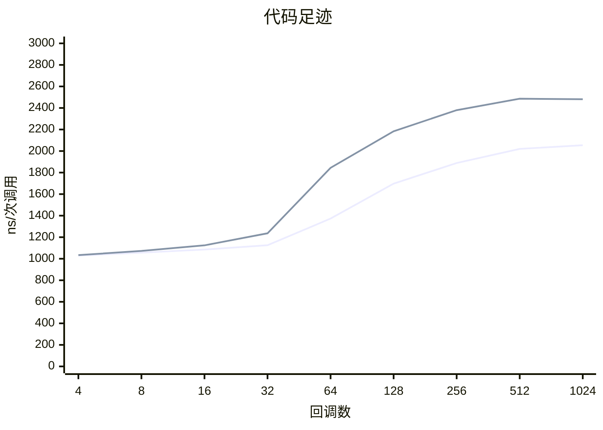
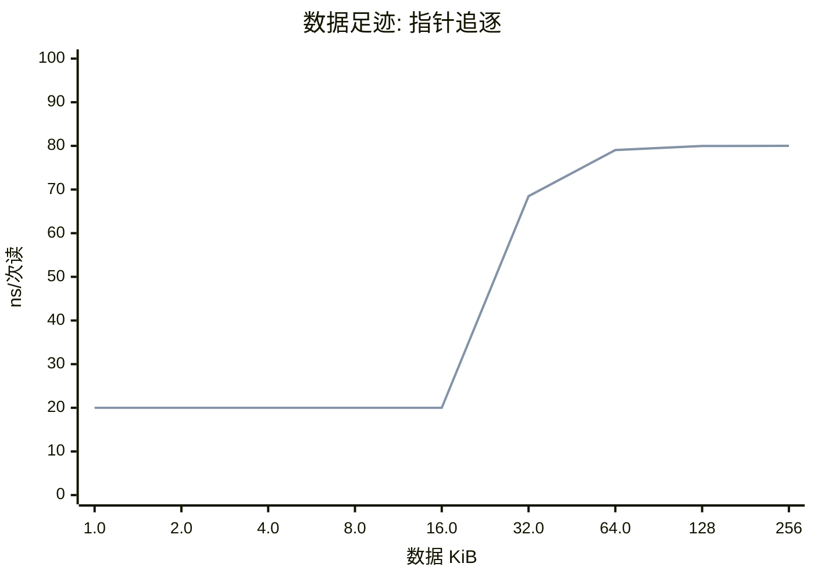
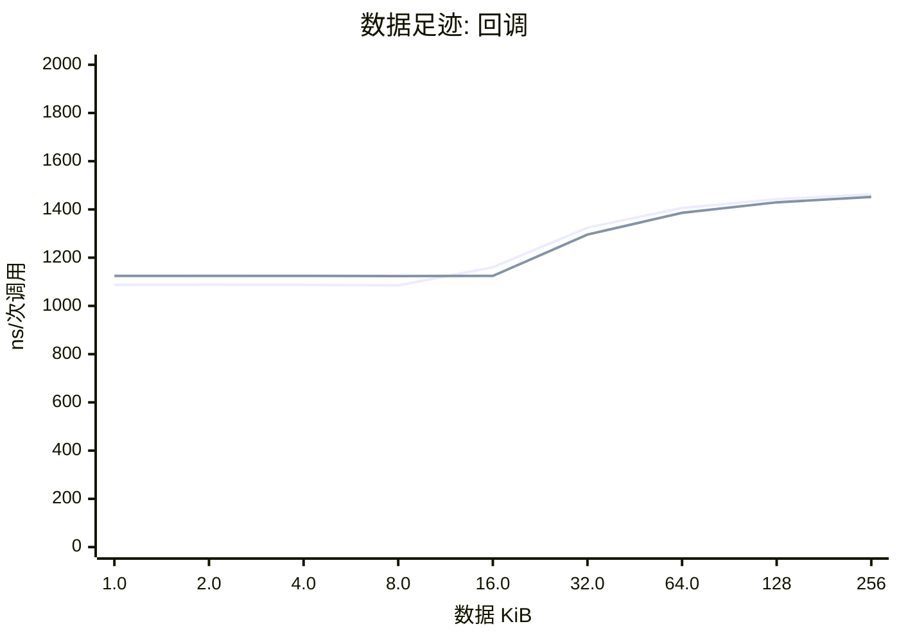
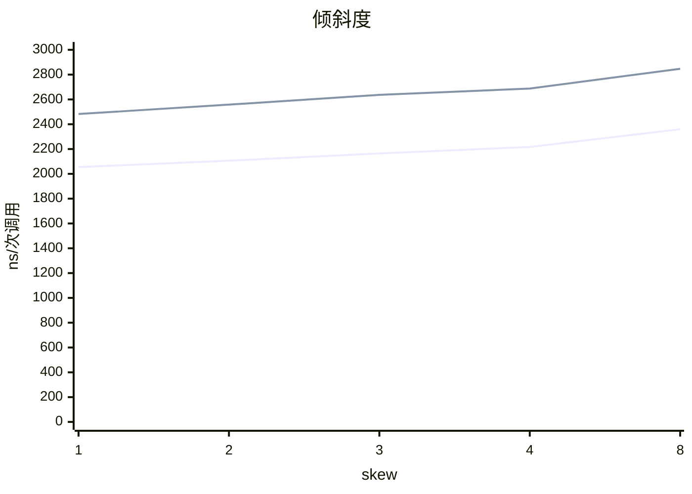

# cachecliff: literal pool vs movw/movt (STM32H743)

数据来源: `h743.txt`, `h743-slow-flash-data.txt`

## 概览

| 项目 | literal pool | movw/movt |
|---|---|---|
| 计时器 | 150 MHz | 150 MHz |
| 回调库 | ebc8ae01 (1024) | ebc8ae01 (1024) |
| 数据区 | 256 KiB | 256 KiB |
| 校验 | 通过 | 通过 |

## 结论

**literal pool**

- 代码足迹的拐点在 **14.3 KiB**（32 个回调）和 28.5 KiB（64 个回调）之间：前者还在热参考的 125% 以内，后者已经超过。指令缓存的有效容量大约就在这里。
- 代码足迹里最陡的一步在 64 到 128 个回调（28.5 到 57.0 KiB）之间，耗时涨到 1.24 倍。
- 全部 1024 个回调时是热参考的 **1.89 倍**。
- 数据读延迟第 1 级：1.0-16.0 KiB，约 **20.0 ns**（3.0 tick）。
- 数据读延迟第 2 级：32.0-256 KiB，约 **79.5 ns**（11.9 tick）。
- 数据足迹的拐点在 **16.0 KiB** 和 32.0 KiB 之间：数据缓存的有效容量大约就在这里。
- 最大的数据区（256 KiB）上，一次依赖读是热参考的 **4.0 倍**，16 个回调的一次调用是热参考的 1.34 倍。
- 选择更集中并没有变快：skew 8 的耗时是均匀的 1.15 倍。skew 每多 1 就多一次随机数抽样，这个开销（几到十几个周期）盖过了热点子集带来的好处，库大而热点子集仍装不进缓存时就会这样。
- 随机顺序的耗时是每 32 次重复的序列的 1.26 倍，一次调用差 280.12 ns（42.0 tick）：这是间接调用预测失败的代价上限。

**movw/movt**

- 代码足迹的拐点在 **16.3 KiB**（32 个回调）和 32.3 KiB（64 个回调）之间：前者还在热参考的 125% 以内，后者已经超过。指令缓存的有效容量大约就在这里。
- 代码足迹里最陡的一步在 32 到 64 个回调（16.3 到 32.3 KiB）之间，耗时涨到 1.49 倍。
- 全部 1024 个回调时是热参考的 **2.20 倍**。
- 数据读延迟第 1 级：1.0-16.0 KiB，约 **20.0 ns**（3.0 tick）。
- 数据读延迟第 2 级：32.0-256 KiB，约 **79.5 ns**（11.9 tick）。
- 数据足迹的拐点在 **16.0 KiB** 和 32.0 KiB 之间：数据缓存的有效容量大约就在这里。
- 最大的数据区（256 KiB）上，一次依赖读是热参考的 **4.0 倍**，16 个回调的一次调用是热参考的 1.29 倍。
- 选择更集中并没有变快：skew 8 的耗时是均匀的 1.15 倍。skew 每多 1 就多一次随机数抽样，这个开销（几到十几个周期）盖过了热点子集带来的好处，库大而热点子集仍装不进缓存时就会这样。
- 随机顺序的耗时是每 32 次重复的序列的 1.26 倍，一次调用差 380.98 ns（57.1 tick）：这是间接调用预测失败的代价上限。

## 代码足迹

图中的线条依次是: 1. literal pool, 2. movw/movt. 只画各文件共有的点。

| 回调数 | 代码 KiB | literal pool ns/次调用 | 相对热参考 | movw/movt ns/次调用 | 相对热参考 |
|---|---|---|---|---|---|
| 4 | 1.8 | 1028.5 | 0.94x | 1033.8 | 0.91x |
| 8 | 3.6 | 1057.0 | 0.97x | 1072.5 | 0.95x |
| 16 | 7.3 | 1085.2 | 0.99x | 1124.3 | 1.00x |
| 32 | 14.3 | 1125.2 | 1.03x | 1236.1 | 1.09x |
| 64 | 28.5 | 1373.0 | 1.26x | 1844.0 | 1.64x |
| 128 | 57.0 | 1697.2 | 1.56x | 2183.7 | 1.94x |
| 256 | 114 | 1889.0 | 1.74x | 2379.7 | 2.11x |
| 512 | 230 | 2020.0 | 1.86x | 2486.1 | 2.21x |
| 1024 | 459 | 2054.0 | 1.89x | 2481.5 | 2.20x |

## 数据足迹

图中的线条依次是: 1. literal pool, 2. movw/movt. 只画各文件共有的点。

图中的线条依次是: 1. literal pool, 2. movw/movt. 只画各文件共有的点。

| 数据 KiB | literal pool ns/次读 | ns/次调用 | movw/movt ns/次读 | ns/次调用 |
|---|---|---|---|---|
| 1.0 | 20.00 | 1087.1 | 20.00 | 1124.5 |
| 2.0 | 20.00 | 1087.7 | 20.00 | 1124.4 |
| 4.0 | 20.00 | 1086.9 | 20.00 | 1124.5 |
| 8.0 | 20.00 | 1085.3 | 20.00 | 1123.9 |
| 16.0 | 20.00 | 1159.9 | 20.00 | 1124.5 |
| 32.0 | 68.52 | 1324.5 | 68.48 | 1295.8 |
| 64.0 | 79.04 | 1406.0 | 79.06 | 1385.8 |
| 128 | 79.98 | 1442.4 | 79.98 | 1429.5 |
| 256 | 80.01 | 1462.3 | 80.01 | 1451.9 |

## 倾斜度

图中的线条依次是: 1. literal pool, 2. movw/movt. 只画各文件共有的点。

## 可预测性

| | random | repeat /32 |
|---|---|---|
| literal pool | 1373.2 ns | 1093.1 ns |
| movw/movt | 1844.7 ns | 1463.7 ns |

## 怎么读

每次只改变一个量，耗时突然变陡的地方就是悬崖。「相对热参考」是对 16 个回调、4 KiB 数据的比值；不超过 125% 的最大足迹叫拐点。指针追逐每次读都依赖上一次的结果，所以它的耗时就是该级存储的读延迟。

由 `tools/ccreport.py` 0.1.0 生成。
