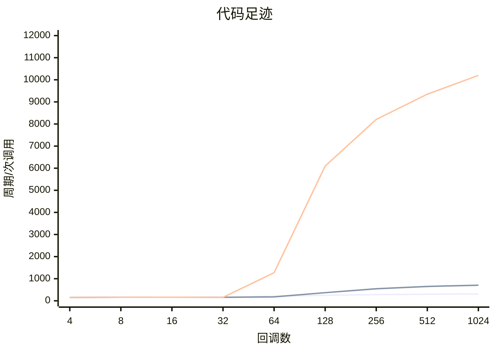
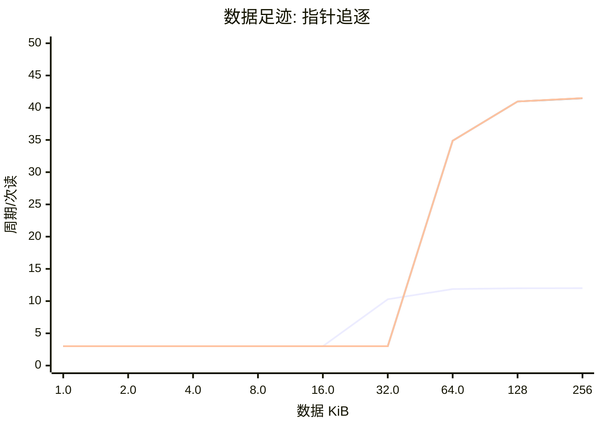
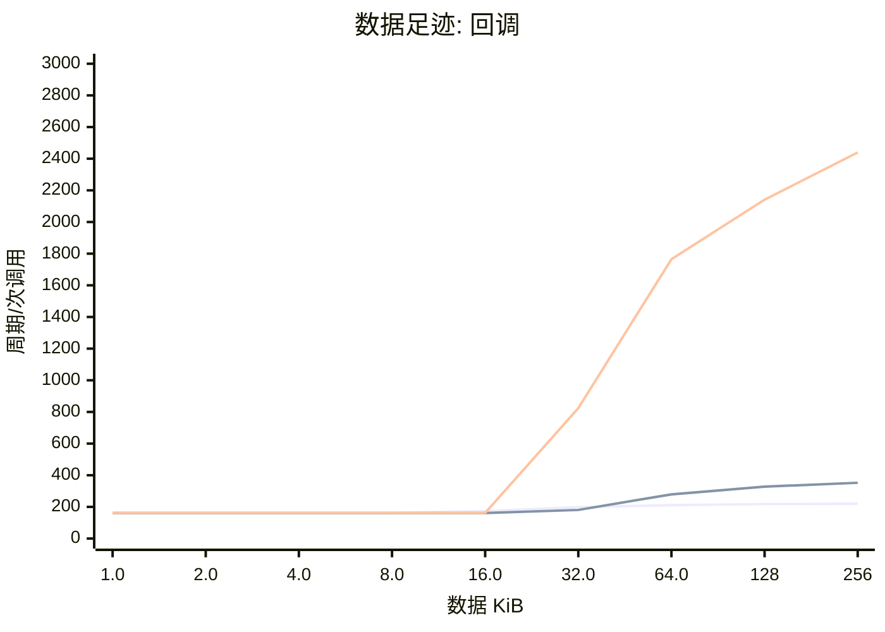
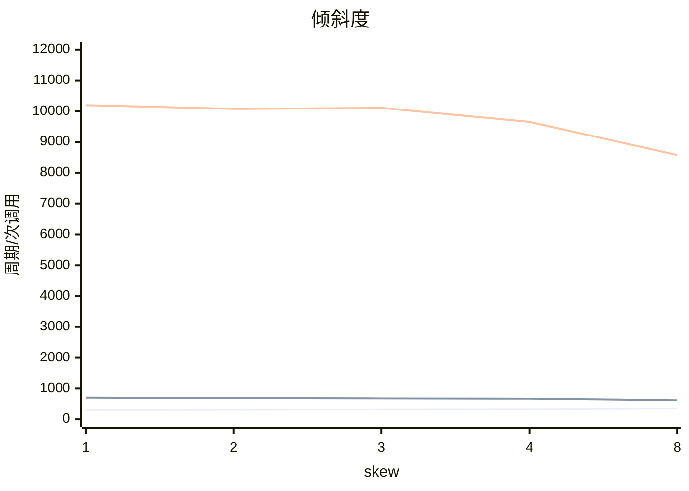

# cachecliff: STM32H743, RT1176 from RAM, RT1176 from QSPI flash (cycles)

数据来源: `h743.csv`, `rt1176-ram.csv`, `rt1176-xip.csv`

## 概览

| 项目 | STM32H743 (Flash) | RT1176 (OCRAM) | RT1176 (QSPI XIP) |
|---|---|---|---|
| 计时器 | 150 MHz | 996 MHz | 996 MHz |
| 回调库 | ebc8ae01 (1024) | ebc8ae01 (1024) | ebc8ae01 (1024) |
| 数据区 | 256 KiB | 256 KiB | 256 KiB |
| 校验 | 通过 | 通过 | 通过 |

## 结论

**STM32H743 (Flash)**

- 代码足迹的拐点在 **14.4 KiB**（32 个回调）和 28.5 KiB（64 个回调）之间：前者还在热参考的 125% 以内，后者已经超过。指令缓存的有效容量大约就在这里。
- 代码足迹里最陡的一步在 32 到 64 个回调（14.4 到 28.5 KiB）之间，耗时涨到 1.23 倍。
- 全部 1024 个回调时是热参考的 **1.90 倍**。
- 数据读延迟第 1 级：1.0-16.0 KiB，约 **3.0 周期**。
- 数据读延迟第 2 级：32.0-256 KiB，约 **11.9 周期**。
- 数据足迹的拐点在 **16.0 KiB** 和 32.0 KiB 之间：数据缓存的有效容量大约就在这里。
- 最大的数据区（256 KiB）上，一次依赖读是热参考的 **4.0 倍**，16 个回调的一次调用是热参考的 1.35 倍。
- 选择更集中并没有变快：skew 8 的耗时是均匀的 1.14 倍。skew 每多 1 就多一次随机数抽样，这个开销（几到十几个周期）盖过了热点子集带来的好处，库大而热点子集仍装不进缓存时就会这样。
- 随机顺序的耗时是每 32 次重复的序列的 1.25 倍，一次调用差 41.54 周期：这是间接调用预测失败的代价上限。

**RT1176 (OCRAM)**

- 代码足迹的拐点在 **28.5 KiB**（64 个回调）和 57.1 KiB（128 个回调）之间：前者还在热参考的 125% 以内，后者已经超过。指令缓存的有效容量大约就在这里。
- 代码足迹里最陡的一步在 64 到 128 个回调（28.5 到 57.1 KiB）之间，耗时涨到 2.05 倍。
- 全部 1024 个回调时是热参考的 **4.37 倍**。
- 数据读延迟第 1 级：1.0-32.0 KiB，约 **3.0 周期**。
- 数据读延迟第 2 级：64.0-256 KiB，约 **41.0 周期**。
- 数据足迹的拐点在 **32.0 KiB** 和 64.0 KiB 之间：数据缓存的有效容量大约就在这里。
- 最大的数据区（256 KiB）上，一次依赖读是热参考的 **13.8 倍**，16 个回调的一次调用是热参考的 2.18 倍。
- 选择越集中越快：skew 8 的耗时只有均匀的 88%，这是一个热点子集能挽回的部分。
- 随机顺序的耗时是每 32 次重复的序列的 1.19 倍，一次调用差 28.50 周期：这是间接调用预测失败的代价上限。

**RT1176 (QSPI XIP)**

- 代码足迹的拐点在 **14.4 KiB**（32 个回调）和 28.5 KiB（64 个回调）之间：前者还在热参考的 125% 以内，后者已经超过。指令缓存的有效容量大约就在这里。
- 代码足迹里最陡的一步在 32 到 64 个回调（14.4 到 28.5 KiB）之间，耗时涨到 8.03 倍。
- 全部 1024 个回调时是热参考的 **63.04 倍**。
- 数据读延迟第 1 级：1.0-32.0 KiB，约 **3.0 周期**。
- 数据读延迟第 2 级：64.0-256 KiB，约 **41.0 周期**。
- 数据足迹的拐点在 **32.0 KiB** 和 64.0 KiB 之间：数据缓存的有效容量大约就在这里。
- 最大的数据区（256 KiB）上，一次依赖读是热参考的 **13.8 倍**，16 个回调的一次调用是热参考的 15.07 倍。
- 选择越集中越快：skew 8 的耗时只有均匀的 84%，这是一个热点子集能挽回的部分。
- 随机顺序的耗时是每 32 次重复的序列的 7.54 倍，一次调用差 1106.25 周期：这是间接调用预测失败的代价上限。

## 代码足迹

图中的线条依次是: 1. STM32H743 (Flash), 2. RT1176 (OCRAM), 3. RT1176 (QSPI XIP). 只画各文件共有的点。

| 回调数 | 代码 KiB | STM32H743 (Flash) 周期/次调用 | 相对热参考 | RT1176 (OCRAM) 周期/次调用 | 相对热参考 | RT1176 (QSPI XIP) 周期/次调用 | 相对热参考 |
|---|---|---|---|---|---|---|---|
| 4 | 1.9 | 152.5 | 0.94x | 150.2 | 0.92x | 150.3 | 0.92x |
| 8 | 3.7 | 161.4 | 0.99x | 159.7 | 0.98x | 160.1 | 0.98x |
| 16 | 7.3 | 162.2 | 1.00x | 161.5 | 1.00x | 161.8 | 0.99x |
| 32 | 14.4 | 166.8 | 1.02x | 158.0 | 0.97x | 158.3 | 0.97x |
| 64 | 28.5 | 205.7 | 1.26x | 179.0 | 1.10x | 1270.9 | 7.85x |
| 128 | 57.1 | 251.2 | 1.54x | 367.7 | 2.27x | 6096.8 | 37.68x |
| 256 | 115 | 280.5 | 1.73x | 545.8 | 3.38x | 8206.4 | 50.72x |
| 512 | 230 | 299.0 | 1.84x | 650.3 | 4.02x | 9348.4 | 57.78x |
| 1024 | 459 | 309.0 | 1.90x | 705.9 | 4.37x | 10200.7 | 63.04x |

## 数据足迹

图中的线条依次是: 1. STM32H743 (Flash), 2. RT1176 (OCRAM), 3. RT1176 (QSPI XIP). 只画各文件共有的点。

图中的线条依次是: 1. STM32H743 (Flash), 2. RT1176 (OCRAM), 3. RT1176 (QSPI XIP). 只画各文件共有的点。

| 数据 KiB | STM32H743 (Flash) 周期/次读 | 周期/次调用 | RT1176 (OCRAM) 周期/次读 | 周期/次调用 | RT1176 (QSPI XIP) 周期/次读 | 周期/次调用 |
|---|---|---|---|---|---|---|
| 1.0 | 3.00 | 162.2 | 3.00 | 161.4 | 3.00 | 161.8 |
| 2.0 | 3.00 | 162.2 | 3.00 | 161.4 | 3.00 | 161.8 |
| 4.0 | 3.00 | 162.2 | 3.00 | 161.4 | 3.00 | 161.8 |
| 8.0 | 3.00 | 162.3 | 3.00 | 161.4 | 3.00 | 161.8 |
| 16.0 | 3.00 | 173.3 | 3.00 | 161.4 | 3.00 | 161.8 |
| 32.0 | 10.28 | 198.2 | 3.00 | 180.8 | 3.00 | 824.2 |
| 64.0 | 11.87 | 211.1 | 34.88 | 279.3 | 34.87 | 1764.8 |
| 128 | 11.99 | 217.6 | 40.97 | 327.9 | 40.97 | 2141.0 |
| 256 | 12.00 | 220.5 | 41.47 | 352.4 | 41.48 | 2439.6 |

## 倾斜度

图中的线条依次是: 1. STM32H743 (Flash), 2. RT1176 (OCRAM), 3. RT1176 (QSPI XIP). 只画各文件共有的点。

## 可预测性

| | random | repeat /32 |
|---|---|---|
| STM32H743 (Flash) | 205.5 ns | 164.0 ns |
| RT1176 (OCRAM) | 179.0 ns | 150.5 ns |
| RT1176 (QSPI XIP) | 1275.5 ns | 169.3 ns |

## 怎么读

每次只改变一个量，耗时突然变陡的地方就是悬崖。「相对热参考」是对 16 个回调、4 KiB 数据的比值；不超过 125% 的最大足迹叫拐点。指针追逐每次读都依赖上一次的结果，所以它的耗时就是该级存储的读延迟。

由 `tools/ccreport.py` 0.1.0 生成。
