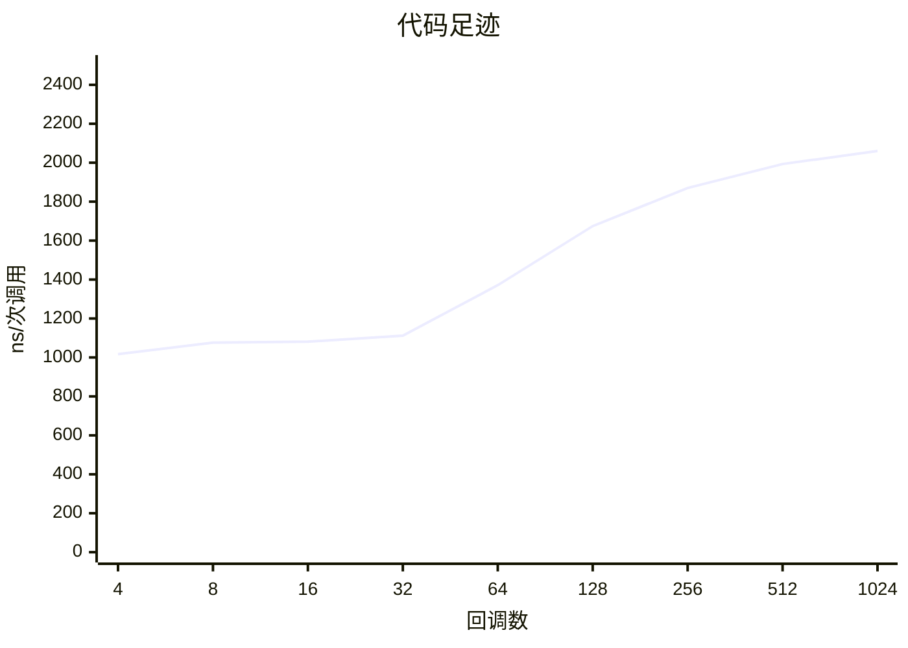
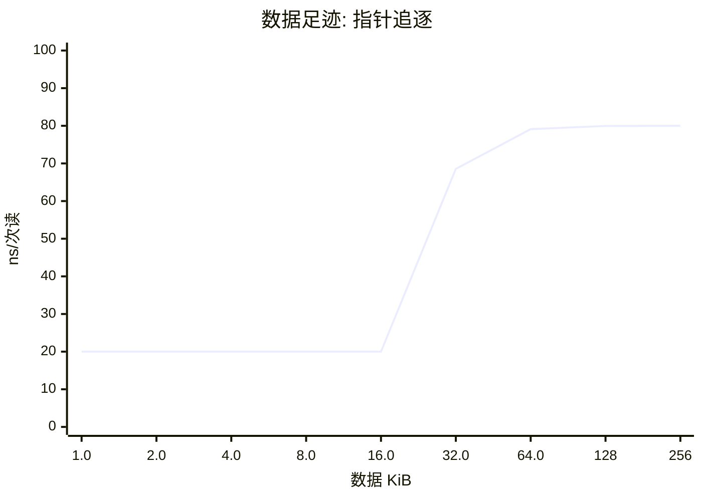
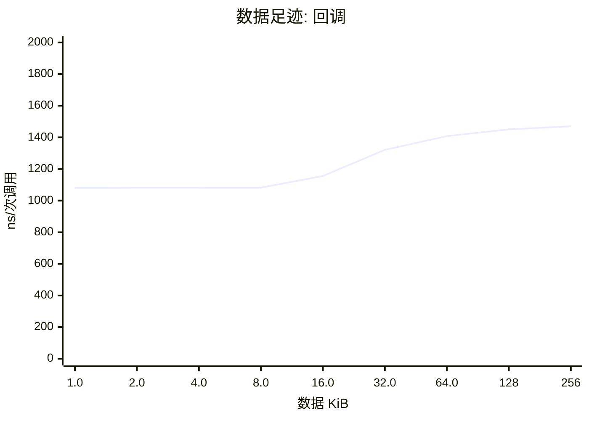

# cachecliff 报告

数据来源: `h743.csv`

## 概览

| 项目 | STM32H743 |
|---|---|
| 计时器 | 150 MHz |
| 回调库 | ebc8ae01 (1024) |
| 数据区 | 256 KiB |
| 校验 | 通过 |

## 结论

- 代码足迹的拐点在 **14.4 KiB**（32 个回调）和 28.5 KiB（64 个回调）之间：前者还在热参考的 125% 以内，后者已经超过。指令缓存的有效容量大约就在这里。
- 代码足迹里最陡的一步在 32 到 64 个回调（14.4 到 28.5 KiB）之间，耗时涨到 1.23 倍。
- 全部 1024 个回调时是热参考的 **1.90 倍**。
- 数据读延迟第 1 级：1.0-16.0 KiB，约 **20.0 ns**（3.0 tick）。
- 数据读延迟第 2 级：32.0-256 KiB，约 **79.5 ns**（11.9 tick）。
- 数据足迹的拐点在 **16.0 KiB** 和 32.0 KiB 之间：数据缓存的有效容量大约就在这里。
- 最大的数据区（256 KiB）上，一次依赖读是热参考的 **4.0 倍**，16 个回调的一次调用是热参考的 1.35 倍。
- 选择更集中并没有变快：skew 8 的耗时是均匀的 1.14 倍。skew 每多 1 就多一次随机数抽样，这个开销（几到十几个周期）盖过了热点子集带来的好处，库大而热点子集仍装不进缓存时就会这样。
- 随机顺序的耗时是每 32 次重复的序列的 1.25 倍，一次调用差 276.91 ns（41.5 tick）：这是间接调用预测失败的代价上限。


## 代码足迹



| 回调数 | 代码 KiB | STM32H743 ns/次调用 | 相对热参考 |
|---|---|---|---|
| 4 | 1.9 | 1016.9 | 0.94x |
| 8 | 3.7 | 1075.8 | 0.99x |
| 16 | 7.3 | 1081.1 | 1.00x |
| 32 | 14.4 | 1111.9 | 1.02x |
| 64 | 28.5 | 1371.1 | 1.26x |
| 128 | 57.1 | 1674.5 | 1.54x |
| 256 | 115 | 1870.2 | 1.73x |
| 512 | 230 | 1993.2 | 1.84x |
| 1024 | 459 | 2060.0 | 1.90x |

## 数据足迹





| 数据 KiB | STM32H743 ns/次读 | ns/次调用 |
|---|---|---|
| 1.0 | 20.00 | 1081.3 |
| 2.0 | 20.00 | 1081.5 |
| 4.0 | 20.00 | 1081.5 |
| 8.0 | 20.00 | 1081.7 |
| 16.0 | 20.00 | 1155.7 |
| 32.0 | 68.56 | 1321.1 |
| 64.0 | 79.12 | 1407.5 |
| 128 | 79.96 | 1450.7 |
| 256 | 80.00 | 1469.9 |

## 倾斜度

```mermaid
xychart-beta
    title "倾斜度"
    x-axis "skew" ["1", "2", "3", "4", "8"]
    y-axis "ns/次调用" 0 --> 2500
    line [2061.05, 2075.1, 2156.74, 2199.78, 2357.51]
```

## 可预测性

| | random | repeat /32 |
|---|---|---|
| STM32H743 | 1370.1 ns | 1093.2 ns |

## 怎么读

每次只改变一个量，耗时突然变陡的地方就是悬崖。「相对热参考」是对 16 个回调、4 KiB 数据的比值；不超过 125% 的最大足迹叫拐点。指针追逐每次读都依赖上一次的结果，所以它的耗时就是该级存储的读延迟。

由 `tools/ccreport.py` 0.1.0 生成。
