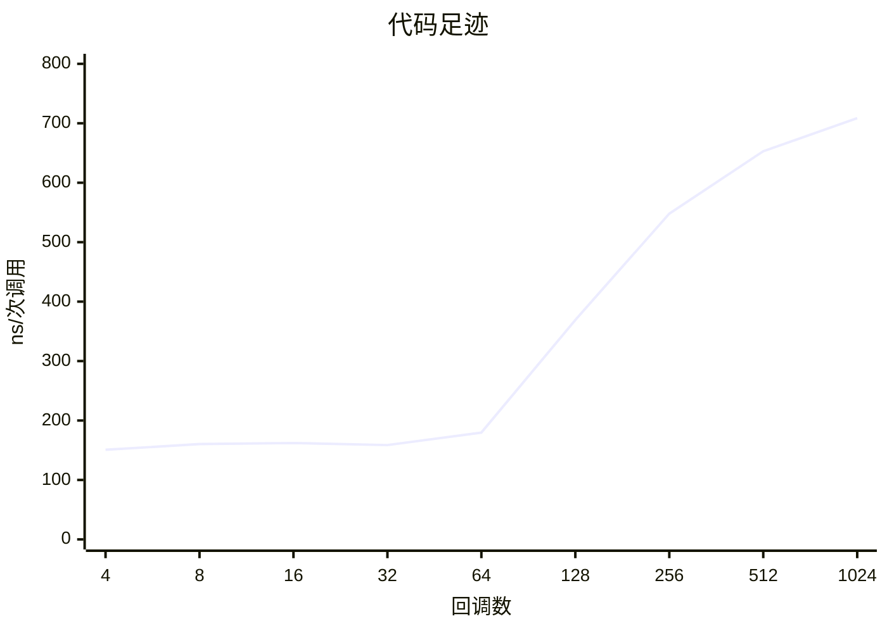
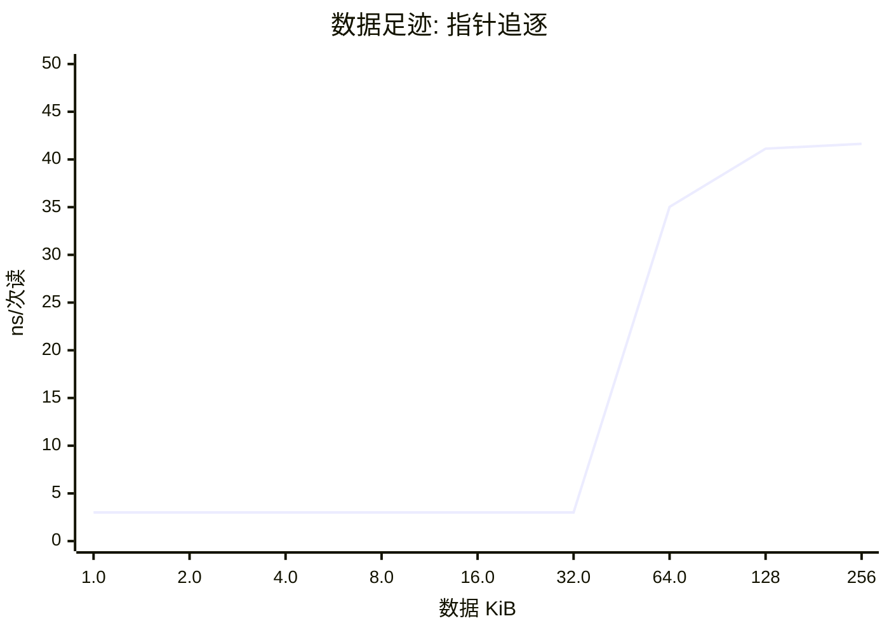
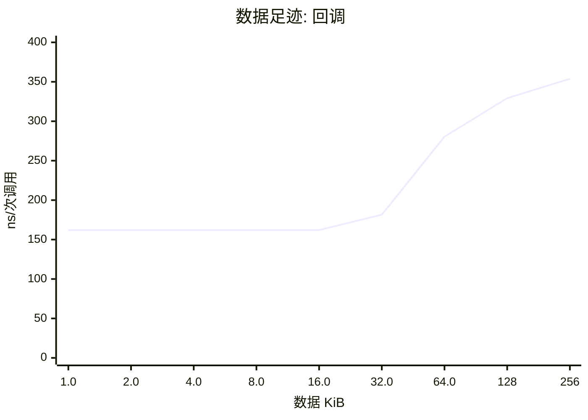

# cachecliff 报告

数据来源: `rt1176-ram.csv`

## 概览

| 项目 | RT1176 (996 MHz) |
|---|---|
| 计时器 | 996 MHz |
| 回调库 | ebc8ae01 (1024) |
| 数据区 | 256 KiB |
| 校验 | 通过 |

## 结论

- 代码足迹的拐点在 **28.5 KiB**（64 个回调）和 57.1 KiB（128 个回调）之间：前者还在热参考的 125% 以内，后者已经超过。指令缓存的有效容量大约就在这里。
- 代码足迹里最陡的一步在 64 到 128 个回调（28.5 到 57.1 KiB）之间，耗时涨到 2.05 倍。
- 全部 1024 个回调时是热参考的 **4.37 倍**。
- 数据读延迟第 1 级：1.0-32.0 KiB，约 **3.0 ns**（3.0 tick）。
- 数据读延迟第 2 级：64.0-256 KiB，约 **41.1 ns**（41.0 tick）。
- 数据足迹的拐点在 **32.0 KiB** 和 64.0 KiB 之间：数据缓存的有效容量大约就在这里。
- 最大的数据区（256 KiB）上，一次依赖读是热参考的 **13.8 倍**，16 个回调的一次调用是热参考的 2.18 倍。
- 选择越集中越快：skew 8 的耗时只有均匀的 88%，这是一个热点子集能挽回的部分。
- 随机顺序的耗时是每 32 次重复的序列的 1.19 倍，一次调用差 28.61 ns（28.5 tick）：这是间接调用预测失败的代价上限。


## 代码足迹



| 回调数 | 代码 KiB | RT1176 (996 MHz) ns/次调用 | 相对热参考 |
|---|---|---|---|
| 4 | 1.9 | 150.8 | 0.92x |
| 8 | 3.7 | 160.3 | 0.98x |
| 16 | 7.3 | 162.1 | 1.00x |
| 32 | 14.4 | 158.7 | 0.97x |
| 64 | 28.5 | 179.7 | 1.10x |
| 128 | 57.1 | 369.1 | 2.27x |
| 256 | 115 | 548.0 | 3.38x |
| 512 | 230 | 652.9 | 4.02x |
| 1024 | 459 | 708.7 | 4.37x |

## 数据足迹





| 数据 KiB | RT1176 (996 MHz) ns/次读 | ns/次调用 |
|---|---|---|
| 1.0 | 3.01 | 162.1 |
| 2.0 | 3.01 | 162.0 |
| 4.0 | 3.01 | 162.1 |
| 8.0 | 3.01 | 162.1 |
| 16.0 | 3.01 | 162.1 |
| 32.0 | 3.01 | 181.5 |
| 64.0 | 35.02 | 280.4 |
| 128 | 41.13 | 329.2 |
| 256 | 41.64 | 353.9 |

## 倾斜度

```mermaid
xychart-beta
    title "倾斜度"
    x-axis "skew" ["1", "2", "3", "4", "8"]
    y-axis "ns/次调用" 0 --> 800
    line [708.53, 695.62, 683.55, 675.95, 623.55]
```

## 可预测性

| | random | repeat /32 |
|---|---|---|
| RT1176 (996 MHz) | 179.7 ns | 151.1 ns |

## 怎么读

每次只改变一个量，耗时突然变陡的地方就是悬崖。「相对热参考」是对 16 个回调、4 KiB 数据的比值；不超过 125% 的最大足迹叫拐点。指针追逐每次读都依赖上一次的结果，所以它的耗时就是该级存储的读延迟。

由 `tools/ccreport.py` 0.1.0 生成。
