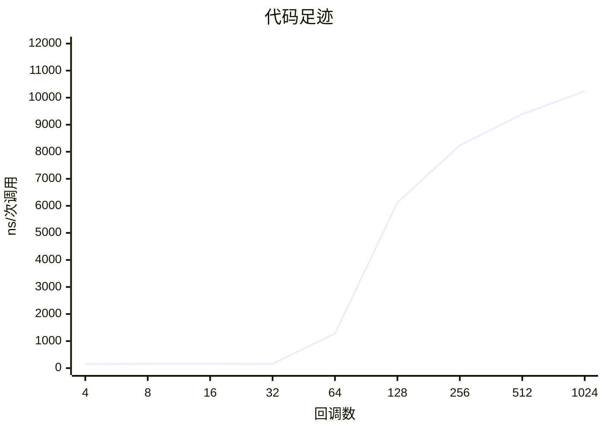
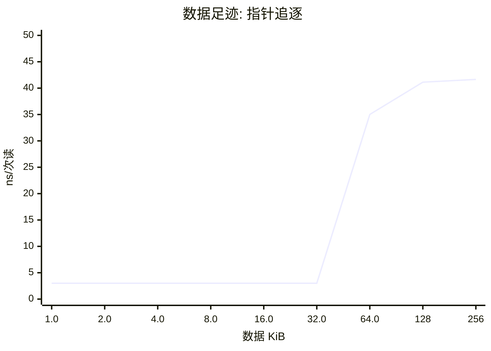
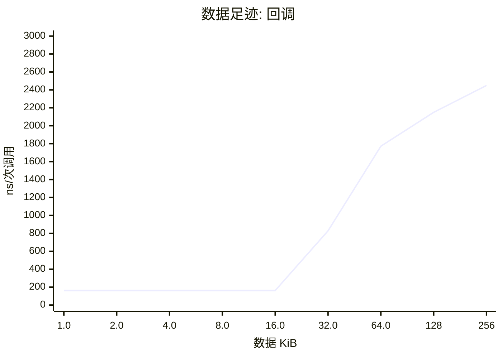
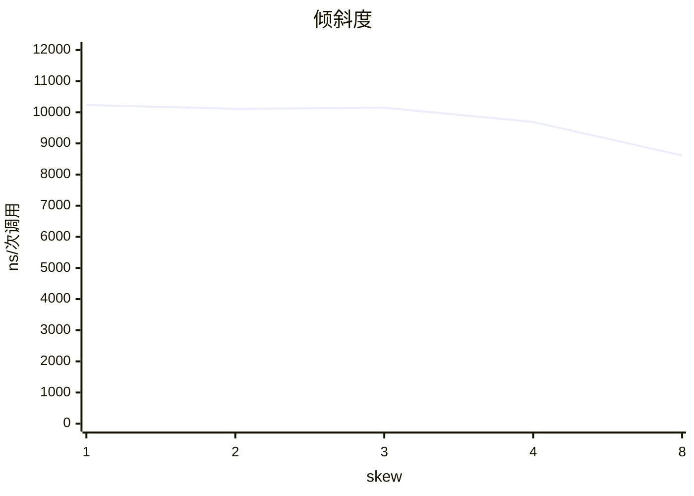

# cachecliff 报告

数据来源: `rt1176-xip.csv`

## 概览

| 项目 | RT1176 XIP |
|---|---|
| 计时器 | 996 MHz |
| 回调库 | ebc8ae01 (1024) |
| 数据区 | 256 KiB |
| 校验 | 通过 |

## 结论

- 代码足迹的拐点在 **14.4 KiB**（32 个回调）和 28.5 KiB（64 个回调）之间：前者还在热参考的 125% 以内，后者已经超过。指令缓存的有效容量大约就在这里。
- 代码足迹里最陡的一步在 32 到 64 个回调（14.4 到 28.5 KiB）之间，耗时涨到 8.03 倍。
- 全部 1024 个回调时是热参考的 **63.04 倍**。
- 数据读延迟第 1 级：1.0-32.0 KiB，约 **3.0 ns**（3.0 tick）。
- 数据读延迟第 2 级：64.0-256 KiB，约 **41.1 ns**（41.0 tick）。
- 数据足迹的拐点在 **32.0 KiB** 和 64.0 KiB 之间：数据缓存的有效容量大约就在这里。
- 最大的数据区（256 KiB）上，一次依赖读是热参考的 **13.8 倍**，16 个回调的一次调用是热参考的 15.07 倍。
- 选择越集中越快：skew 8 的耗时只有均匀的 84%，这是一个热点子集能挽回的部分。
- 随机顺序的耗时是每 32 次重复的序列的 7.54 倍，一次调用差 1110.69 ns（1106.2 tick）：这是间接调用预测失败的代价上限。

## 代码足迹

| 回调数 | 代码 KiB | RT1176 XIP ns/次调用 | 相对热参考 |
|---|---|---|---|
| 4 | 1.9 | 150.9 | 0.92x |
| 8 | 3.7 | 160.8 | 0.98x |
| 16 | 7.3 | 162.4 | 0.99x |
| 32 | 14.4 | 158.9 | 0.97x |
| 64 | 28.5 | 1276.0 | 7.85x |
| 128 | 57.1 | 6121.3 | 37.68x |
| 256 | 115 | 8239.3 | 50.72x |
| 512 | 230 | 9385.9 | 57.78x |
| 1024 | 459 | 10241.6 | 63.04x |

## 数据足迹

| 数据 KiB | RT1176 XIP ns/次读 | ns/次调用 |
|---|---|---|
| 1.0 | 3.01 | 162.5 |
| 2.0 | 3.01 | 162.5 |
| 4.0 | 3.01 | 162.4 |
| 8.0 | 3.01 | 162.4 |
| 16.0 | 3.01 | 162.4 |
| 32.0 | 3.01 | 827.5 |
| 64.0 | 35.01 | 1771.9 |
| 128 | 41.13 | 2149.6 |
| 256 | 41.65 | 2449.3 |

## 倾斜度

## 可预测性

| | random | repeat /32 |
|---|---|---|
| RT1176 XIP | 1280.6 ns | 169.9 ns |

## 怎么读

每次只改变一个量，耗时突然变陡的地方就是悬崖。「相对热参考」是对 16 个回调、4 KiB 数据的比值；不超过 125% 的最大足迹叫拐点。指针追逐每次读都依赖上一次的结果，所以它的耗时就是该级存储的读延迟。

由 `tools/ccreport.py` 0.1.0 生成。
